### `root@simran:~# whoami`

**Ethical Hacker | VAPT Analyst | Aspiring Penetration Tester**

*Web Application Security • Network Reconnaissance • Digital Forensics • Red Teaming*

---

## `01 // About Me`

I focus on understanding how systems fail and how to secure them through practical, authorized security testing. My current interests are **web application VAPT, penetration testing, network security, red-team fundamentals and digital forensics**.

- 🎯 Current focus: VAPT, web application security and penetration testing
- 🧪 Hands-on: security labs, CTF challenges and technical projects
- 🛠️ Building: practical security tools and investigation utilities
- 📍 Based in India | Open to entry-level cybersecurity opportunities

## `02 // Technical Arsenal`

**Security & Assessment**

**Platforms & Development**

**Methodologies:** OWASP Top 10 · MITRE ATT&CK · Vulnerability Assessment · Security Testing

## `03 // Project Repositories`

Organised by security domain and development area:

| Repository | Focus |
|---|---|
| [🔐 Security-Projects](https://github.com/Simrankaur1000/Security-Projects) | Password security and application-security projects |
| [🌐 Network-Security](https://github.com/Simrankaur1000/Network-Security) | Network reconnaissance and security tooling |
| [🕵️ Digital-Forensics-DFIR-](https://github.com/Simrankaur1000/Digital-Forensics-DFIR-) | Windows artefact collection and digital forensics |
| [💻 Development-Projects](https://github.com/Simrankaur1000/Development-Projects) | Software development projects and experiments |
| [🚩 CTF-Writeups](https://github.com/Simrankaur1000/CTF-Writeups) | Authorized CTF and security-lab writeups |

### Featured Work

- **[AutoTrace-Windows](https://github.com/Simrankaur1000/Digital-Forensics-DFIR-/tree/main/AutoTrace-Windows)** — Windows artefact collection for browser history and failed logon events.
- **[Network Reconnaissance Toolkit](https://github.com/Simrankaur1000/Network-Security/tree/main/simple-network-scanner-toolkit)** — CLI wrapper for network discovery and enumeration tools.
- **[Password Strength Checker](https://github.com/Simrankaur1000/Security-Projects/tree/main/password-checker-web-app)** — Flask-based password-strength checker with Have I Been Pwned range lookups.
- **[Development Project](https://github.com/Simrankaur1000/Development-Projects/tree/main/anti-gravity)** — Software development project and experiments.

## `04 // GitHub Activity`

### Contribution Snake

## `05 // Certifications & Achievements`

- **CRTA** — Certified Red Team Analyst
- **CRTOM** — Certified Red Team Operations Management
- **CLLMSP** — Certified LLM Security Professional
- **AZ-900** — Microsoft Azure Fundamentals
- 🏆 **BrainCon 2025 — 2nd Place**, Team Syntax Terror

## `06 // Education`

- **M.Sc. Advanced Networking & Cyber Security** — Brainware University · CGPA: 8.81
- **BCA** — Jyoti Nivas College

---

### `ACCESS GRANTED // THANK YOU FOR VISITING`

*Learning. Testing. Investigating. Securing.*

All security testing is performed in authorized environments.

